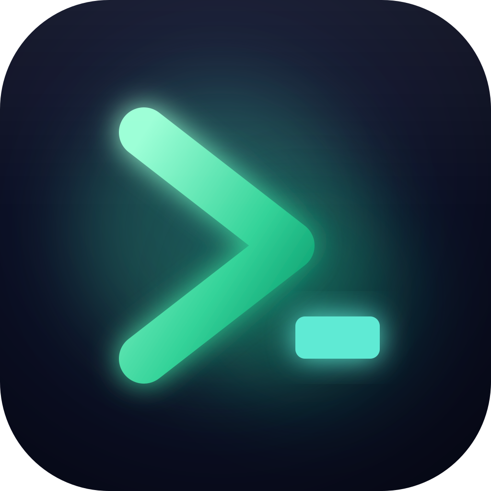

<p align="center">
  
</p>

<h1 align="center">Clinch</h1>

<p align="center">
  <strong>The local-first macOS terminal for Claude Code and Codex.</strong>
</p>

<p align="center">
  <a href="https://clinch.sh"><strong>Website</strong></a> ·
  <a href="#install"><strong>Install</strong></a> ·
  <a href="https://clinch.sh/docs"><strong>Docs</strong></a> ·
  <a href="https://github.com/elliot-ylambda/clinch-terminal/releases"><strong>Releases</strong></a>
</p>

<p align="center">
  <sub>macOS 14+ · Apple Silicon · free and open source · no account · no telemetry</sub>
</p>

---

Clinch is a terminal for running several AI coding agents at once. It is an open-source fork of
Warp with the account, cloud features, and telemetry taken out.

- **Pick up where you left off.** After a restart, Claude Code, Codex, and Devin conversations
  reopen in the pane they were in.
- **Keep projects apart.** Each project keeps its own tabs, splits, and folders.
- **See who needs you.** Tab badges and notifications show when an agent is waiting or done.
- **Answer from your phone.** Optional [Remote Control](#remote-control-beta) over your own
  Tailscale network.
- **Stay private.** No account, analytics, or crash reporting. See [Privacy](#privacy).

## Install

```bash
curl -fsSL https://clinch.sh/install | sh
```

The script checks the release signature before it installs Clinch to `/Applications`. Clinch then
updates itself: **Update** appears in the header, and nothing installs until you click it.

To verify the download by hand, or for Intel Macs, see [Install, update, and remove](docs/install.md).

## Privacy

Clinch collects nothing and does not talk to Warp's servers. The only request it makes on its own
is an update check against GitHub, at most once an hour.

| What | When | Where it goes |
| --- | --- | --- |
| Update check | At most hourly; you can turn it off | GitHub |
| Plan-limit gauges | Off unless you turn them on | Anthropic, or your own `codex` CLI |
| Remote Control | Off unless you turn it on | Your own Tailscale network |
| Agents, SSH, language servers, MCP | Only when you run them | Their own services |

Turn off the update check in **Settings → Clinch → Updates**. For the details and how to check
all of this yourself, see [Privacy](docs/privacy.md).

## Session restore

Clinch adds hooks to Claude Code, Codex, and Devin so it can reopen their conversations after a
restart. A session that was mid-task picks up where it stopped; the rest come back asleep until you
click **Wake**. Turn this off in **Settings → Agents**. More in [Sessions](docs/sessions.md).

## Remote Control (beta)

Check on and reply to your running agents from Safari on your phone. Your Mac stays the host, and
the connection runs over your own Tailscale network, with no Clinch account or relay. It is off
until you turn it on in **Settings → Clinch → Remote Control**. More in
[Remote Control](docs/remote-control.md).

## Good to know

- **Public preview.** Clinch is signed but not notarized by Apple, and it has not had an
  independent security audit. See [SECURITY.md](SECURITY.md).
- **Computer use** needs the Accessibility and Screen Recording permissions.
  [Setup and fixes](docs/install.md#computer-use-permissions-on-macos).
- **Uninstall** with `bash uninstall.sh` from any release.
  [Options](docs/install.md#uninstall).
- **Runs alongside Warp.** Clinch keeps its own settings in `~/.clinch`.

## Build from source

```bash
./script/bootstrap
./script/install_cargo_test_deps
./script/launch-check
make candidate
```

Testing, releases, and cleanup tools: [Building, releasing, and maintenance](docs/development.md).

## License

Clinch is a modified version of [Warp](https://github.com/warpdotdev/warp), licensed under
[AGPL-3.0](LICENSE-AGPL). The `warpui_core` and `warpui` crates are [MIT](LICENSE-MIT). Clinch is
not affiliated with Warp or Denver Technologies, Inc. Commercial-use notes:
[docs/licensing.md](docs/licensing.md).
